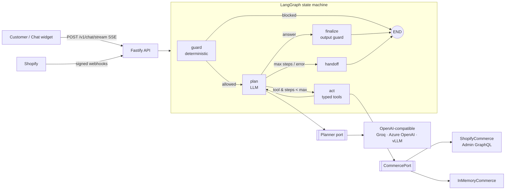

# commerce-ops-agent

[](https://github.com/ndanetaadmire-debug/commerce-ops-agent/actions/workflows/ci.yml)


**A production-grade AI operations agent for e-commerce.** It answers customers about live stock, order status, delivery windows and returns, and routes anything involving money to a human — without ever being able to promise what the system didn't do.

Extracted and generalised from the agent I built for **Lwazi Hair**, a live South African retailer on Shopify.

```
Customer: "my frontal arrived torn, order 1043, lindiwe@example.com"
  ▸ guard        allowed
  ▸ plan         escalate_refund  (damaged item reported)
  ▸ tool         escalate_refund  ok  12ms
  ▸ plan         answer
  ▸ output_guard unbacked_refund_claim → corrected
Agent: "I'm sorry about that. Your refund request has been passed to our team.
        Your reference is ESC-4F1A92C0; a team member will confirm the outcome by email."
```

---

## Why this repo exists

Most agent demos are a prompt and a `while` loop. This one treats the agent as **software with contracts**:

| Concern | How it's handled |
|---|---|
| Prompt injection / jailbreaks | Deterministic **input guard** runs *before* the model (Unicode-normalised, zero-width-stripped). Hostile input costs zero tokens. |
| Hallucinated actions | Model may only call **4 Zod-typed tools**. Unknown tools and bad arguments become recoverable errors fed back to the planner. |
| False promises | **Output guard** checks the reply against the tool ledger — "your refund is approved" is rewritten unless policy actually approved it. |
| Money movement | Refunds are **tickets, not transactions**. Auto-approval is a business rule in code (default limit R0 = always human). |
| Data leakage | Order lookups need **order number + checkout email**; errors are indistinguishable so the tool can't be used to enumerate orders. PII is redacted from logs. |
| Runaway loops / cost | Bounded tool loop (`MAX_TOOL_STEPS`), then a graceful **human handoff**. Provider outages also hand off. |
| Vendor lock-in | Hexagonal **ports & adapters**: swap Shopify ↔ in-memory, Groq ↔ Azure OpenAI ↔ vLLM with config. |
| Testability | The **real LangGraph graph** is tested offline with a scripted planner — no network, no flaky LLM calls in CI. |
| Webhooks | Shopify HMAC verified over the raw body in constant time; at-least-once deliveries **deduped** by webhook ID; ack < 5s. |

## Architecture



Full write-up: **[docs/ARCHITECTURE.md](docs/ARCHITECTURE.md)** · Decisions: **[docs/adr](docs/adr)**

## Project layout

```
src/
  agent/          LangGraph state + graph (guard → plan ⇄ act → finalize | handoff)
  guardrails/     inputGuard, outputGuard, PII redaction
  tools/          check_stock, track_order, estimate_delivery, escalate_refund + registry
  ports/          CommercePort, Planner (interfaces the core depends on)
  adapters/       ShopifyCommerce, InMemoryCommerce, OpenAiCompatiblePlanner
  http/           Fastify server, SSE streaming, webhooks, rate limit, sessions
  config.ts       Zod-validated env, fail-fast
test/             48 tests: guardrails, tools, graph, adapters, HTTP
```

## Quick start

```bash
cp .env.example .env          # add an LLM key (Groq has a free tier)
npm ci
npm run dev                   # http://localhost:8080 with the in-memory store

curl -N localhost:8080/v1/chat/stream \
  -H 'content-type: application/json' \
  -d '{"sessionId":"6f1c1a2e-6d4b-4a3e-9b1d-0c6f5a1b2c3d","message":"Is the 12 inch bob in stock?"}'
```

Point it at a real store with `COMMERCE_ADAPTER=shopify` plus `SHOPIFY_*` variables. Config is validated at boot; missing secrets stop the process rather than failing on the first customer.

```bash
npm run ci        # typecheck + tests + build
docker build -t commerce-ops-agent . && docker run -p 8080:8080 --env-file .env commerce-ops-agent
```

## API

| Method | Path | Purpose |
|---|---|---|
| `POST` | `/v1/chat` | One turn, JSON response with `reply`, `outcome` (`answered` / `blocked` / `handoff`) and step `trace` |
| `POST` | `/v1/chat/stream` | Same, as Server-Sent Events: `step` per graph node, then `final`, then `done` |
| `POST` | `/webhooks/shopify` | HMAC-verified, idempotent order webhooks |
| `GET`  | `/healthz` | Liveness |

## Roadmap

- Redis-backed sessions, rate limits and webhook dedupe for horizontal scale (ADR-003)
- OpenTelemetry spans per graph node; token and latency budgets per conversation
- Eval harness: golden conversations scored on tool choice, policy adherence and tone
- WhatsApp Business channel adapter

---

Built by **[Admire T. Ndaneta](https://admire-portfolio.vercel.app)** — senior full-stack & AI engineer. MIT licensed.
